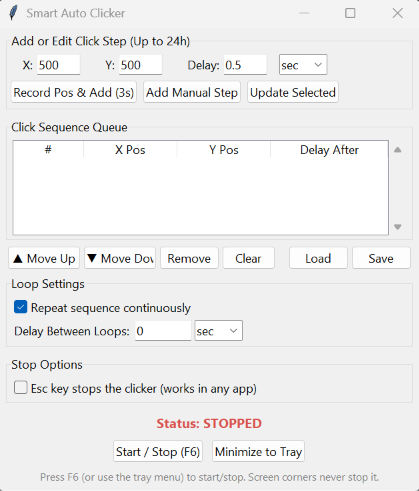

# Smart Auto Clicker

A multi-step auto clicker for desktop that clicks a **sequence of screen positions**, each with its own delay (from 0.01 seconds up to 24 hours), and can repeat the sequence on a loop. It has a small Tkinter interface, a global hotkey, a system-tray icon, and saveable presets.





## Features

- **Multi-position sequences:** build a queue of clicks, each with its own X/Y position and its own delay.
- **Flexible delays:** from 0.01 seconds to 24 hours per step, entered in seconds, minutes, or hours.
- **Loop control:** repeat the whole sequence continuously with an optional delay between loops, or run it once.
- **Easy position capture:** click **Record Pos & Add**, move your mouse to the target during the 3-second countdown, and the position is added to the queue.
- **Queue editing:** add manual steps, update, reorder, remove, or clear steps.
- **Live status:** shows the current step and a countdown to the next click.
- **Global hotkey:** press **F6** from any app to start or stop.
- **System tray:** minimize to the tray and control the clicker from the tray menu (Windows/Linux).
- **Presets:** save and load sequences as JSON files. Loaded files are fully validated, so a broken or hand-edited preset can't corrupt the app.
- **Keeps Windows awake** while a run is active, so long delays aren't interrupted by sleep.
- **Resilient:** a single failed click is skipped and logged. The run only aborts after 5 failures in a row.
- **Optional safeties:** a corner fail-safe and an Esc-key stop, both **off by default** so a stray mouse movement can't stop a long run.
- **Stays out of the way:** the window minimizes when you press Start and returns when the run finishes, so it can't intercept clicks.

## Installation

You need Python 3.9 or newer.

```bash
git clone https://github.com/<Acr0Crypt0>/smart-auto-clicker.git
cd smart-auto-clicker
pip install -r requirements.txt
python smart_auto_clicker.py
```

## Usage

1. **Add steps.** Either click **Record Pos & Add (3s)** and move the mouse to the target, or type X/Y, a delay and a unit, then click **Add Manual Step**. The delay on a step is the wait *after* that click.
2. **Arrange the queue.** Select a step to edit it (then **Update Selected**), move it up or down, remove it, or clear everything.
3. **Set the loop.** Tick **Repeat sequence continuously** and choose a delay between loops, or untick it to run the sequence once.
4. **Start.** Press **Start / Stop (F6)** or the **F6** key. The window minimizes while the sequence runs.
5. **Stop.** Press **F6** again, or use **Start / Stop** from the tray menu.

### Safety options

| Option | Default | What it does |
| --- | --- | --- |
| Corner fail-safe | Off | Stops the run if the mouse touches a screen corner. When on, steps positioned at a corner are rejected. |
| Esc key stops the clicker | Off | Lets Esc stop the run from any app. |

Both are off by default so that brushing a corner or pressing Esc in another app doesn't end a long run by accident. **F6 always works**, from the keyboard or the tray menu. With both options off, F6 is your only emergency stop, so make sure you know where it is before starting a long run.

### Presets

Presets are plain JSON. See [`examples/example_preset.json`](examples/example_preset.json):

```json
{
    "steps": [
        { "x": 400, "y": 300, "delay": 1.0 },
        { "x": 600, "y": 400, "delay": 0.5 },
        { "x": 800, "y": 500, "delay": 30.0 }
    ],
    "loop_enabled": true,
    "loop_delay": "5",
    "loop_unit": "sec"
}
```

Coordinates are absolute pixels on the **primary screen**, so a preset recorded on a different resolution may click the wrong spots. Check the list after loading one.

## Build a Windows executable

```bash
build_exe.bat
```

This installs PyInstaller and builds `dist\SmartAutoClicker\SmartAutoClicker.exe`. The equivalent manual command is:

```bash
pyinstaller --noconsole --onedir --name SmartAutoClicker ^
  --hidden-import pystray._win32 ^
  --hidden-import pynput.keyboard._win32 ^
  --hidden-import pynput.mouse._win32 ^
  smart_auto_clicker.py
```

`--onedir` is recommended over `--onefile`: it starts faster and is flagged by antivirus software less often.

## Platform support

| Platform | Status |
| --- | --- |
| Windows | Supported and tested. |
| Linux | Should work under X11. Wayland generally blocks global hotkeys and synthetic input, so it is not expected to work. Untested. |
| macOS | Runs without the tray icon; the window's close button quits the app. You must grant Accessibility/Input Monitoring permission. Untested. |

## Troubleshooting

- **Hotkeys or tray icon don't work in the built .exe:** make sure the `--hidden-import` flags above were included.
- **Antivirus or SmartScreen warning:** unsigned executables that install a global keyboard hook and send mouse input are commonly flagged as false positives. Build it yourself from source, or add an exclusion for the folder.
- **Nothing happens while the PC is locked:** a locked screen or a secure prompt (UAC) can swallow clicks without any error. Keep the session unlocked during a run.
- **Clicks land in the wrong place:** coordinates are absolute pixels. Re-record the positions after changing resolution, scaling, or monitor setup.
- **Something failed:** check the log at `%LOCALAPPDATA%\SmartAutoClicker\log.txt` (or `~/SmartAutoClicker/log.txt` on other systems).

## Responsible use

This tool sends real mouse clicks and clicks **blindly**: it does not look at what is under the cursor. Double-check your positions before starting, and never point it at buttons like *Delete*, *Confirm*, or *Buy*. Many online games and services prohibit automated input in their terms of service, so make sure you are allowed to use it where you run it. You are responsible for how you use it.

## Contributing

Issues and pull requests are welcome. For larger changes, please open an issue first to discuss what you'd like to change.

## License

Released under the [MIT License](LICENSE).
